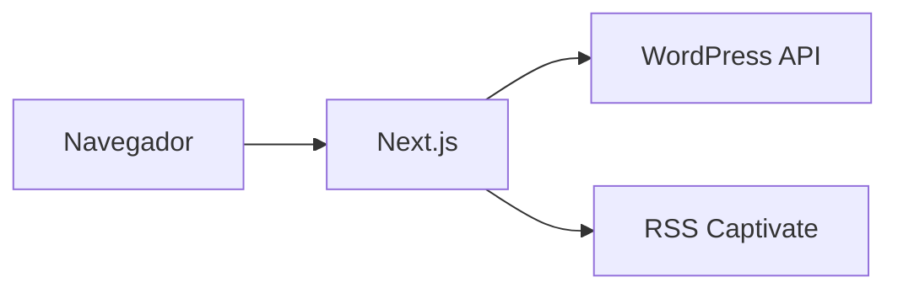

# DOCUMENTACIÓN TÉCNICA — Radio Dos (Radio2)

**Proyecto:** Sitio web y reproductor de Radio Dos (Radio2), emisora de Grupo Columbia, Costa Rica
**Paquete:** `radio-dos` v0.1.0
**Desarrollado por:** Aurigital
**Dominio de producción:** https://radiodos.com
**Última actualización:** Noviembre 2026

---

## Índice

1. [Resumen del proyecto](#1-resumen-del-proyecto)
2. [Arquitectura y estructura](#2-arquitectura-y-estructura)
3. [Documentación técnica detallada](#3-documentación-técnica-detallada)
4. [Dependencias](#4-dependencias)
5. [Convenciones de código](#5-convenciones-de-código)
6. [Guía de Clean Code](#6-guía-de-clean-code)
7. [Checklist de despliegue](#7-checklist-de-despliegue)
8. [Buenas prácticas de Handoff](#8-buenas-prácticas-de-handoff)
9. [Buenas prácticas de documentación técnica en Markdown](#9-buenas-prácticas-de-documentación-técnica-en-markdown)
10. [Deuda técnica y mejoras recomendadas](#10-deuda-técnica-y-mejoras-recomendadas)
11. [Anexo: Migración de WordPress](#11-anexo-migración-de-wordpress)

---

## 1. Resumen del proyecto

Radio Dos es un sitio web *headless* que combina:

- **Reproductor de radio en vivo** persistente en todas las páginas (stream de Radio.co).
- **Noticias**, consumidas desde un WordPress headless mediante su API REST.
- **Podcasts / programas**, consumidos desde feeds RSS de Captivate.fm.
- **Páginas institucionales**: Nosotros, Contacto (formulario con EmailJS) y enlace al Media Kit.
- **SEO y analítica**: metadatos Open Graph, JSON-LD (schema.org `RadioStation`), sitemap dinámico, `robots.txt` y Google Analytics 4.

### Stack tecnológico

| Capa | Tecnología |
|---|---|
| Framework | Next.js 16 (App Router) |
| UI | React 18 |
| Lenguajes | TypeScript 5 y JavaScript (mixto, `allowJs: true`) |
| Estilos | Tailwind CSS 3.4 + PostCSS + Autoprefixer |
| Animaciones | Framer Motion |
| Carruseles | react-slick + slick-carousel |
| Iconos | lucide-react, react-icons |
| Parseo de RSS | xml2js |
| Correo | @emailjs/browser |
| Analítica | Google Analytics 4 (`G-ZY4PPFPEJK`) vía `next/script` |
| CMS de contenido | WordPress (`radiodos.aurigital.com`) por REST API |

### Servicios externos

| Servicio | Uso | URL / identificador |
|---|---|---|
| WordPress REST API | Noticias, categorías, etiquetas | `https://radiodos.aurigital.com/wp-json/wp/v2` |
| Radio.co (stream) | Audio en vivo | `https://s5.radio.co/sd515b7b34/listen` |
| Radio.co (status) | Canción actual (polling cada 15 s) | `https://public.radio.co/stations/sd515b7b34/status` |
| Captivate.fm | Feeds RSS de podcasts | `https://feeds.captivate.fm/<programa>/` |
| iTunes Search API | Carátula de la canción en vivo | `https://itunes.apple.com/search` |
| EmailJS | Envío del formulario de contacto | Configurado en `ContactForm.jsx` |
| Google Analytics 4 | Métricas de uso | `G-ZY4PPFPEJK` |
| Media Kit | Enlace externo | `https://grupocolumbia.co.cr/media-kit` |

---

## 2. Arquitectura y estructura

### Estructura de carpetas

```text
radiodos/
├── docs/                          # Documentación del proyecto
├── lib/api.js                     # Helper heredado (getPosts)
├── Migracion/                     # Guía y script de migración de WordPress
├── public/                        # Estáticos: isotipo, imágenes de programas (.avif), manifest
├── src/
│   ├── app/                       # App Router de Next.js
│   │   ├── (pages)/
│   │   │   ├── about-us/          # /about-us
│   │   │   ├── contact/           # /contact
│   │   │   └── news/              # /news y /news/[slug]
│   │   ├── api/
│   │   │   ├── artwork/route.ts   # Proxy a iTunes con caché en memoria (24 h)
│   │   │   └── rss/route.ts       # Parseo y caché de feeds RSS (1 h)
│   │   ├── layout.js              # Layout raíz, metadatos, GA4, JSON-LD, providers
│   │   ├── page.jsx               # Home (/)
│   │   ├── not-found.tsx          # 404
│   │   ├── robots.js              # robots.txt dinámico
│   │   ├── sitemap.js             # sitemap.xml dinámico (estáticas + posts)
│   │   └── globals.css
│   ├── components/
│   │   ├── SEO/JsonLd.jsx
│   │   ├── UI/                    # NewsCard, PodcastCard
│   │   ├── about-us/  contact/  home/  news/   # Componentes por página
│   │   ├── Navbar.tsx  Footer.jsx  RadioPlayer.tsx  SplashPage.jsx
│   ├── lib/
│   │   ├── PlayerContext.tsx      # Estado global del reproductor
│   │   ├── SearchContext.tsx      # Estado global de búsqueda
│   │   ├── wordpressService.ts    # Cliente de WordPress REST
│   │   ├── rssService.ts          # Servicio de podcasts (metadatos locales + RSS)
│   │   ├── rssConfig.ts           # Timeouts, caché y reintentos del RSS
│   │   └── seo.js                 # Utilidades SEO
│   └── types/                     # Tipos: podcast.ts, wordpress.ts
├── next.config.mjs
├── tailwind.config.js
├── tsconfig.json / jsconfig.json  # Alias `@/*` → `./src/*`
└── package.json
```

### Flujo de datos

```text
Navegador ──► Next.js (App Router)
               ├─► wordpressService ──► WordPress REST API   (noticias)
               ├─► /api/rss ──────────► Captivate.fm (RSS)   (podcasts, caché 1 h)
               ├─► /api/artwork ──────► iTunes Search API    (carátulas, caché 24 h)
               └─► RadioPlayer ───────► Radio.co (stream + status cada 15 s)
```

### Estado global

El layout raíz envuelve la aplicación en dos *providers*:

- `SearchProvider` (`SearchContext`): término de búsqueda compartido entre Navbar y listados de noticias.
- `PlayerProvider` (`PlayerContext`): tipo de reproducción (`radio` | `podcast`), episodio y lista actuales, reproducción/pausa, siguiente y anterior. `RadioPlayer` permanece montado entre navegaciones para no interrumpir el audio.

---

## 3. Documentación técnica detallada

### 3.1 Noticias (WordPress)

`src/lib/wordpressService.ts` expone la clase estática `WordPressService`:

| Método | Descripción |
|---|---|
| `getPosts(options)` | Lista paginada con filtros: `page`, `perPage`, `categories`, `tags`, `search`, `orderBy`, `exclude`, `include`. Devuelve `posts`, `totalPages`, `totalItems`, `currentPage` (leídos de `X-WP-TotalPages` y `X-WP-Total`). |
| `getPostBySlug(slug)` | Un post por *slug* (`null` si no existe). |
| `getRelatedPosts(categoryId, excludeId, limit)` | Posts relacionados por categoría. |
| `getCategories()` | Categorías y mapa `slug → id`. |

Las rutas de noticias usan `?_embed` para traer imagen destacada, autor y términos en una sola petición. La ruta `/news/[slug]` genera metadatos dinámicos con `generateMetadata`.

### 3.2 Podcasts (RSS)

- Los metadatos de cada programa (título, descripción, imagen, autor, horario y URL del feed) están definidos **localmente** en `src/lib/rssService.ts`; el contenido de episodios viene del RSS.
- `src/app/api/rss/route.ts` descarga el feed con `AbortController` (timeout), lo parsea con `xml2js` y lo cachea con `unstable_cache` (`revalidate: 3600`).
- `src/lib/rssConfig.ts` centraliza: `REQUEST_TIMEOUT` (8 s), `CACHE_DURATION` (1 h), `MAX_RETRIES` (2), `RETRY_DELAY` (800 ms), cabeceras y tamaño de lote (`BATCH_SIZE`).
- **Para agregar un programa:** añadir su entrada (con `rssUrl`) en la lista de metadatos de `rssService.ts` y su imagen `.avif` en `public/assets/programas/`.

### 3.3 Reproductor de radio

`src/components/RadioPlayer.tsx`:

- Reproduce el stream de Radio.co y consulta el estado de la emisora cada 15 s para mostrar la canción actual.
- Solicita la carátula a `/api/artwork?title=...` (proxy a iTunes, caché en memoria de 24 h por título).
- Reproduce también episodios de podcast con control de siguiente/anterior mediante `PlayerContext`.

### 3.4 SEO y analítica

- Metadatos globales, Open Graph, Twitter, `manifest` e iconos en `layout.js` (`metadataBase: https://radiodos.com`).
- JSON-LD `RadioStation` inyectado en el layout; `components/SEO/JsonLd.jsx` para casos por página.
- `sitemap.js` incluye páginas estáticas y **todos los posts** (paginando de 100 en 100).
- `robots.js` bloquea `/api/`, `/admin/`, `/_next/`, `/private/` y los *crawlers* de IA (`GPTBot`, `ChatGPT-User`, `CCBot`, `anthropic-ai`, `Claude-Web`).
- GA4 cargado con `next/script` (`strategy="afterInteractive"`).

### 3.5 Seguridad y rendimiento (`next.config.mjs`)

- Cabeceras: `X-Content-Type-Options: nosniff`, `X-Frame-Options: DENY`, `X-XSS-Protection`, `Referrer-Policy: origin-when-cross-origin`.
- Imágenes remotas permitidas (`remotePatterns`): `radiodev.aurigital.com`, `radiodos.aurigital.com` (`/wp-content/uploads/**`), `artwork.captivate.fm`, `cdn.captivate.fm`.
- Formatos de imagen: `avif` y `webp`. Compresión activada. `optimizePackageImports` para `lucide-react`.
- Caché HTTP para `/sitemap.xml` (1 h + *stale-while-revalidate*) y `/robots.txt` (24 h).

### 3.6 Formulario de contacto

`components/contact/ContactForm.jsx` usa `emailjs.sendForm` desde el navegador. Las claves de EmailJS (service/template/public key) son públicas por diseño, pero deben moverse a variables de entorno (ver [sección 10](#10-deuda-técnica-y-mejoras-recomendadas)).

### 3.7 Renderizado

Las páginas `/` y `/news` usan `'use client'` con `export const dynamic = 'force-dynamic'`. Las rutas de API gestionan su propia caché.

---

## 4. Dependencias

### 4.1 Requisitos del entorno

| Requisito | Versión recomendada |
|---|---|
| Node.js | 20 LTS o superior (Next.js 16 lo requiere) |
| npm | 10 o superior |
| Git | Cualquier versión reciente |

### 4.2 Dependencias de producción

| Paquete | Versión | Uso |
|---|---|---|
| `next` | ^16.2.12 | Framework (App Router, SSR, API routes) |
| `react` / `react-dom` | ^18.2.0 | Librería de UI |
| `@next/third-parties` | ^16.3.0 | Integraciones de terceros optimizadas |
| `framer-motion` | ^12.40.0 | Animaciones |
| `lucide-react` | ^0.525.0 | Iconos |
| `react-icons` | ^5.0.1 | Iconos (redes sociales, etc.) |
| `react-slick` | ^0.30.3 | Carruseles |
| `slick-carousel` | ^1.8.1 | Estilos base de los carruseles |
| `xml2js` | ^0.6.2 | Parseo de feeds RSS |
| `@emailjs/browser` | ^4.4.1 | Envío de correos desde el cliente |
| `@types/xml2js` | ^0.4.14 | Tipos (debería estar en `devDependencies`) |

### 4.3 Dependencias de desarrollo

| Paquete | Versión | Uso |
|---|---|---|
| `typescript` | ^5.3.3 | Tipado estático |
| `tailwindcss` | ^3.4.1 | Utilidades CSS |
| `postcss` | ^8.4.31 | Procesamiento CSS |
| `autoprefixer` | ^10.4.21 | Prefijos de navegador |
| `@types/node`, `@types/react`, `@types/react-dom` | ^20 / ^18 / ^18 | Tipos |

### 4.4 Scripts disponibles

| Comando | Acción |
|---|---|
| `npm run dev` | Servidor de desarrollo (`http://localhost:3000`) |
| `npm run build` | Build de producción |
| `npm run start` | Sirve el build de producción |
| `npm run lint` | Linter de Next.js |

### 4.5 Instalación local

```bash
git clone <url-del-repositorio>
cd radiodos
npm install
npm run dev
```

### 4.6 Política de actualización de dependencias

- Usar `npm ci` en CI y despliegues para respetar `package-lock.json`.
- Revisar `npm outdated` y `npm audit` al menos una vez al mes.
- Actualizar de a una dependencia mayor por *pull request*; probar `build` y las rutas principales.
- No subir `node_modules/` ni `.next/` (ya están en `.gitignore`).

---

## 5. Convenciones de código

### 5.1 Nomenclatura

| Elemento | Convención | Ejemplo |
|---|---|---|
| Componentes React | `PascalCase`, archivo con el mismo nombre | `NewsCard.tsx` |
| Hooks | `camelCase` con prefijo `use` | `usePlayer` |
| Variables y funciones | `camelCase` | `fetchStatus` |
| Constantes globales | `UPPER_SNAKE_CASE` | `RADIO_STREAM`, `RSS_CONFIG` |
| Tipos e interfaces | `PascalCase` | `PodcastEpisode` |
| Carpetas de rutas | `kebab-case` (URL) | `about-us` |
| Carpetas de componentes | Agrupadas por página/dominio | `components/news/` |
| Imágenes en `public/` | Formato `.avif`, nombres descriptivos | `RockandLocuras.avif` |

### 5.2 Lenguaje y tipado

- **Código nuevo en TypeScript** (`.ts` / `.tsx`). El código `.js/.jsx` existente se migra de forma gradual.
- `strict: true` está activo: evitar `any`; definir tipos en `src/types/`.
- Usar el alias `@/` para importar desde `src/` (nunca rutas relativas largas como `../../../`).

### 5.3 Componentes

- Un componente por archivo; exportación por defecto para componentes.
- Preferir **Server Components**. Usar `'use client'` solo cuando haya estado, efectos o APIs del navegador.
- Mantener los componentes pequeños (idealmente < 200 líneas). Extraer lógica a hooks o servicios.
- Props tipadas con `interface`, desestructuradas en la firma.

### 5.4 Estilos

- Tailwind CSS como herramienta principal; evitar CSS en línea y archivos CSS nuevos.
- Orden sugerido de clases: *layout → tamaño/espaciado → tipografía → color → estados → responsive*.
- Diseño **mobile-first**: base para móvil y prefijos `md:`, `lg:` para pantallas mayores.
- Tipografías del proyecto: `font-bebas` (títulos) y `font-archivo` (texto).
- Color de marca principal: `#1E305F` (también usado como `themeColor`).

### 5.5 Imágenes y accesibilidad

- Usar `next/image` y declarar dominios remotos en `next.config.mjs`.
- Todo ``/`Image` debe tener `alt` descriptivo.
- Botones e iconos interactivos con `aria-label`. Contraste suficiente. Navegación por teclado.

### 5.6 Acceso a datos

- Toda llamada a servicios externos pasa por un **servicio** en `src/lib/` o por una ruta en `src/app/api/`; los componentes no hacen `fetch` directo a terceros.
- Manejar siempre errores (`try/catch`) y estados de carga/vacío.
- URLs, tiempos y claves en constantes o variables de entorno, no repetidas en el código.

### 5.7 Git

- **Ramas:** `main` (producción) y ramas de trabajo por funcionalidad o corrección, con nombres en `kebab-case` (`feature/media-kit`, `fix/player-pause`).
- **Commits:** mensajes cortos, en imperativo y descriptivos. Se recomienda [Conventional Commits](https://www.conventionalcommits.org/es/): `feat:`, `fix:`, `docs:`, `refactor:`, `chore:`.
- Pull requests pequeños, con descripción de qué cambia y cómo probarlo.
- Nunca subir secretos ni archivos `.env*`.

### 5.8 Formato

- Indentación de 2 espacios, comillas simples en JS/TS, punto y coma al final de cada sentencia, líneas de hasta ~100 caracteres.
- Se recomienda añadir Prettier y ESLint con reglas compartidas (ver sección 10).

---

## 6. Guía de Clean Code

Principios aplicados al contexto de este proyecto (React + Next.js + TypeScript).

### 6.1 Nombres que revelan intención

```ts
// ❌ Mal
const d = 8000;
const fn = (x) => x.filter((p) => p.s === 1);

// ✅ Bien
const REQUEST_TIMEOUT_MS = 8000;
const getPublishedPosts = (posts: WordPressPost[]) =>
  posts.filter((post) => post.status === 'publish');
```

### 6.2 Funciones pequeñas con una sola responsabilidad

- Una función hace **una** cosa y su nombre la describe.
- Máximo 3 parámetros; si hay más, usar un objeto de opciones (como `GetPostsOptions`).
- Evitar efectos secundarios ocultos.

### 6.3 Evitar números y textos "mágicos"

Extraer a constantes con nombre (`STATUS_POLL_INTERVAL = 15000`) o a configuración (`RSS_CONFIG`).

### 6.4 DRY, KISS y YAGNI

- **DRY:** no duplicar lógica. Ejemplo a mejorar: la URL base de WordPress aparece en `lib/api.js` y en `wordpressService.ts`.
- **KISS:** la solución más simple que funcione.
- **YAGNI:** no construir funcionalidad "por si acaso".

### 6.5 Retornos tempranos en lugar de anidación

```ts
// ❌ Mal
if (res.ok) {
  const data = await res.json();
  if (data.length) {
    return data[0];
  }
}
return null;

// ✅ Bien
if (!res.ok) throw new Error(`Error ${res.status}`);
const data = await res.json();
return data[0] ?? null;
```

### 6.6 Manejo de errores

- No tragar errores en silencio (`catch {}` vacío). Registrar o devolver un valor de respaldo explícito.
- Mensajes de error útiles, con contexto.
- Mostrar al usuario un estado de error amigable, no una pantalla en blanco.

### 6.7 Comentarios

- El código debe explicarse solo; comentar el **porqué**, no el **qué**.
- Eliminar código muerto y comentado (Git conserva el historial).
- Los `TODO` deben incluir contexto y responsable.

### 6.8 Separación de responsabilidades

- UI en `components/`, lógica de datos en `lib/`, tipos en `types/`, endpoints en `app/api/`.
- Los componentes no conocen detalles de las APIs externas.

### 6.9 Componentes React

- Componentes de presentación puros cuando sea posible.
- Evitar `useEffect` innecesarios: derivar valores en el render antes que sincronizar estado.
- Limpiar siempre efectos (`clearInterval`, `removeEventListener`), como en el polling de `RadioPlayer`.
- Listas con `key` estable (id), nunca el índice si el orden puede cambiar.

### 6.10 Regla del Boy Scout

> Deja el código un poco más limpio de como lo encontraste.

### 6.11 Checklist de Clean Code antes de un PR

- [ ] Nombres claros y consistentes.
- [ ] Funciones y componentes pequeños y con una sola responsabilidad.
- [ ] Sin código duplicado, comentado ni `console.log` olvidados.
- [ ] Sin valores "mágicos" ni claves en el código.
- [ ] Errores y estados de carga/vacío manejados.
- [ ] Tipos correctos, sin `any`.
- [ ] `npm run lint` y `npm run build` sin errores.

---

## 7. Checklist de despliegue

### 7.1 Antes del despliegue

**Código**
- [ ] La rama de trabajo está integrada con `main` y sin conflictos.
- [ ] `npm ci` instala sin errores.
- [ ] `npm run lint` sin errores.
- [ ] `npm run build` termina correctamente.
- [ ] `npm run start` local: se revisan Home, `/news`, una noticia, `/about-us` y `/contact`.
- [ ] Sin `console.log` ni código de depuración.

**Configuración**
- [ ] Variables de entorno definidas en el entorno de destino (ver 7.4).
- [ ] `remotePatterns` de `next.config.mjs` incluye todos los dominios de imágenes en uso.
- [ ] URL base de WordPress apunta al entorno correcto (producción: `radiodos.aurigital.com`).
- [ ] ID de GA4 correcto para producción.

**Contenido y SEO**
- [ ] Título, descripción e imagen Open Graph correctos.
- [ ] `favicon`, `apple-touch-icon` y `site.webmanifest` presentes.
- [ ] `/sitemap.xml` y `/robots.txt` responden correctamente.
- [ ] Datos estructurados (JSON-LD) válidos.

**Servicios externos**
- [ ] La API de WordPress responde y devuelve posts.
- [ ] Los feeds RSS de Captivate.fm responden.
- [ ] El stream y el endpoint de estado de Radio.co funcionan.
- [ ] El formulario de contacto envía el correo (EmailJS).

### 7.2 Durante el despliegue

1. Crear el build de producción: `npm ci && npm run build`.
2. Publicar la versión en el hosting (por ejemplo Vercel, o servidor Node con `npm run start`).
3. Verificar que el build termina sin errores y que el servicio queda en estado *healthy*.
4. Mantener identificada la versión anterior para poder revertir.

### 7.3 Verificación posterior (smoke test)

- [ ] El sitio carga por HTTPS en `https://radiodos.com`.
- [ ] El reproductor inicia el stream y muestra la canción actual y su carátula.
- [ ] El reproductor sigue sonando al navegar entre páginas.
- [ ] Las noticias cargan; la paginación, los filtros y la búsqueda funcionan.
- [ ] Una noticia individual muestra imagen, contenido y relacionadas.
- [ ] Los podcasts cargan episodios y se reproducen.
- [ ] El formulario de contacto envía correctamente.
- [ ] Diseño responsive correcto en móvil, tableta y escritorio.
- [ ] GA4 registra la visita (Tiempo real).
- [ ] Sin errores en la consola del navegador ni en los logs del servidor.
- [ ] Lighthouse: Rendimiento, Accesibilidad, SEO y Buenas prácticas revisados.
- [ ] Cabeceras de seguridad presentes (`X-Frame-Options`, `nosniff`, etc.).

### 7.4 Variables de entorno

Actualmente el proyecto **no depende de variables de entorno**: URLs, el ID de GA4 y los IDs de EmailJS están en el código. Se recomienda migrarlos así:

| Variable | Descripción |
|---|---|
| `NEXT_PUBLIC_WP_API_URL` | Base de la API de WordPress |
| `NEXT_PUBLIC_GA_ID` | ID de Google Analytics 4 |
| `NEXT_PUBLIC_EMAILJS_SERVICE_ID` | Service ID de EmailJS |
| `NEXT_PUBLIC_EMAILJS_TEMPLATE_ID` | Template ID de EmailJS |
| `NEXT_PUBLIC_EMAILJS_PUBLIC_KEY` | Public key de EmailJS |
| `NEXT_PUBLIC_SITE_URL` | URL canónica del sitio |

Los archivos `.env*` están ignorados por Git; el equipo debe compartir los valores por un canal seguro.

### 7.5 Plan de reversión (rollback)

1. Redesplegar la versión anterior estable (o revertir el *commit* en `main`).
2. Purgar caché del CDN, si aplica.
3. Repetir el smoke test de la sección 7.3.
4. Documentar el incidente y su causa.

---

## 8. Buenas prácticas de Handoff

El *handoff* es la entrega del proyecto a otro equipo o persona. Su objetivo es que quien lo recibe pueda operarlo, mantenerlo y evolucionarlo sin depender de quien lo entrega.

### 8.1 Principios

- **Autosuficiencia:** todo lo necesario para entender y ejecutar el proyecto está escrito.
- **Reproducibilidad:** quien recibe puede levantar el proyecto desde cero siguiendo la documentación.
- **Transparencia:** se declaran la deuda técnica, los riesgos y los pendientes.
- **Trazabilidad:** las decisiones importantes y su motivo quedan registradas.

### 8.2 Checklist de entrega

**Acceso y propiedad**
- [ ] Acceso al repositorio (con rol adecuado) para el nuevo equipo.
- [ ] Acceso al hosting/despliegue y al dominio/DNS.
- [ ] Acceso al WordPress headless (usuarios y roles).
- [ ] Acceso a EmailJS, Google Analytics 4, Radio.co y Captivate.fm.
- [ ] Credenciales entregadas por gestor de contraseñas, **nunca** por chat o correo en texto plano.
- [ ] Rotación de claves tras la entrega, cuando aplique.

**Código y documentación**
- [ ] Repositorio limpio, `main` estable y etiquetado (*tag*) con la versión entregada.
- [ ] Este documento revisado y actualizado.
- [ ] Instrucciones de instalación probadas en una máquina limpia.
- [ ] Lista de variables de entorno con ejemplo (`.env.example`).
- [ ] Diagrama de arquitectura y de flujo de datos actualizados.
- [ ] Deuda técnica y pendientes documentados (sección 10).

**Operación**
- [ ] Proceso de despliegue y *rollback* documentado (sección 7).
- [ ] Puntos de monitoreo definidos (disponibilidad, errores, analítica).
- [ ] Contactos de cada proveedor y responsable por servicio.
- [ ] Calendario de renovaciones (dominio, hosting, licencias).

**Transferencia de conocimiento**
- [ ] Sesión de recorrido del código (walkthrough) grabada.
- [ ] Demostración de despliegue en vivo, ejecutada por quien recibe.
- [ ] Periodo de acompañamiento acordado para dudas posteriores.
- [ ] Acta de entrega firmada por ambas partes.

### 8.3 Plantilla de acta de entrega

```markdown
## Acta de entrega — <Proyecto>

- Fecha:
- Entrega:
- Recibe:
- Versión / tag entregado:
- Accesos transferidos: (lista)
- Pendientes conocidos: (lista con prioridad)
- Riesgos conocidos: (lista)
- Periodo de soporte posterior:
- Firmas:
```

### 8.4 Registro de decisiones (ADR)

Para cada decisión técnica relevante, añadir un registro corto:

```markdown
### ADR-001: Usar WordPress como CMS headless
- Estado: Aceptada
- Contexto: El equipo editorial ya gestiona contenido en WordPress.
- Decisión: Consumir la REST API desde Next.js.
- Consecuencias: Dependencia de la disponibilidad de la API; necesidad de caché.
```

### 8.5 Errores comunes a evitar

- Documentación que solo existe en la memoria del equipo saliente.
- Credenciales compartidas por canales inseguros o sin rotar.
- Entregar sin que el receptor haya hecho un despliegue por su cuenta.
- Omitir la deuda técnica "para no preocupar".

---

## 9. Buenas prácticas de documentación técnica en Markdown

### 9.1 Estructura recomendada

- Un solo `#` (título) por documento; después, jerarquía continua `##`, `###` sin saltar niveles.
- Incluir un **índice** con enlaces en documentos largos.
- Orden sugerido: resumen → arquitectura → instalación → uso → operación → referencias.
- Mantener párrafos cortos y listas para contenido escaneable.

### 9.2 Estilo de redacción

- Escribir en el mismo idioma y tono (aquí: español, voz directa).
- Frases cortas y términos consistentes (no alternar "endpoint", "ruta" y "servicio" para lo mismo).
- Explicar el **porqué**, no solo el **qué**.
- Evitar información que caduca rápido (versiones exactas dentro del texto); referirse a `package.json`.

### 9.3 Bloques de código

- Indicar siempre el lenguaje: ` ```bash `, ` ```ts `, ` ```json `.
- Los comandos deben poder copiarse y ejecutarse tal cual.
- Usar `código en línea` para nombres de archivos, variables y comandos.

### 9.4 Tablas, listas y avisos

- Tablas para comparar o catalogar (dependencias, variables, servicios).
- Listas numeradas para pasos secuenciales; viñetas para elementos sin orden.
- Casillas `- [ ]` para checklists.
- Citas `>` para notas y advertencias destacadas.

### 9.5 Diagramas

- Preferir diagramas como texto (ASCII o Mermaid) para que se versionen con Git.

````markdown

````

### 9.6 Enlaces y rutas

- Enlaces relativos para archivos del repositorio (`./docs/archivo.md`).
- Textos de enlace descriptivos (evitar "clic aquí").
- Verificar enlaces rotos periódicamente.

### 9.7 Mantenimiento

- La documentación vive en el repositorio (`/docs`) y se actualiza **en el mismo PR** que cambia el comportamiento.
- Incluir fecha de última actualización y responsable.
- Revisarla en cada *release* y en cada *handoff*.
- Mantener un `README.md` breve en la raíz que apunte a esta documentación.

### 9.8 Plantilla mínima de README

```markdown
# Nombre del proyecto
Descripción en una línea.

## Requisitos
## Instalación
## Scripts
## Variables de entorno
## Estructura
## Despliegue
## Documentación
```

---

## 10. Deuda técnica y mejoras recomendadas

Observaciones del estado actual del código, ordenadas por prioridad.

| Prioridad | Hallazgo | Recomendación |
|---|---|---|
| Alta | IDs de EmailJS, GA4 y URLs de WordPress escritos en el código. | Moverlos a variables de entorno (sección 7.4) y añadir `.env.example`. |
| Alta | No hay pruebas automatizadas ni CI. | Añadir pruebas (Vitest/Jest + Testing Library) y un *pipeline* con lint, tipos y build. |
| Media | Existen dos configuraciones de PostCSS (`postcss.config.js` y `postcss.config.mjs`); la segunda referencia `@tailwindcss/postcss`, que no está en `package.json`, mientras que Tailwind instalado es la v3. | Conservar solo la configuración vigente; si se migra a Tailwind v4, actualizar dependencias y configuración. |
| Media | Mezcla de JS y TS. | Migrar gradualmente a TypeScript. |
| Media | `lib/api.js` (raíz) duplica la lógica y la URL de `wordpressService.ts`. | Eliminarlo o reemplazar su uso por `WordPressService`. |
| Media | `@types/xml2js` está en `dependencies`. | Moverlo a `devDependencies`. |
| Media | `/` y `/news` son `'use client'` con `force-dynamic`: no aprovechan el renderizado de servidor ni la caché. | Migrar la obtención de datos a Server Components con `revalidate`. |
| Media | La caché de `/api/artwork` es en memoria; se pierde en cada reinicio y no se comparte entre instancias. | Usar `unstable_cache` o una caché externa si se escala. |
| Baja | `site.webmanifest` aparece en `public/` y en `src/app/`. | Mantener una sola fuente. |
| Baja | No hay ESLint/Prettier con reglas propias documentadas. | Añadir `.eslintrc` y `.prettierrc` y un *hook* de pre-commit (Husky + lint-staged). |
| Baja | `next-env.d.ts` está ignorado por Git. | Es el comportamiento esperado; se regenera con `next dev`/`build`. |

---

## 11. Anexo: Migración de WordPress

La carpeta `Migracion/` contiene la documentación y el script usados para trasladar el contenido de WordPress desde un respaldo SQL a una nueva instalación en Hostinger:

- `Migracion/GUIA_COMPLETA_MIGRACION_WORDPRESS.md`: guía paso a paso (arquitectura, proceso, problemas resueltos, importación en phpMyAdmin, verificación y uso futuro).
- `Migracion/migration_processor_FINAL.py`: script de procesamiento (mapeo de autores, división de archivos grandes, corrección de URLs, filtrado de metadatos, manejo de encoding).
- `Migracion/SQL_Files/06_Fixes/`: correcciones SQL (por ejemplo, codificación de categorías).

Resultado documentado de la migración: 109 posts, 226 *attachments*, 22 538 metadatos filtrados, autores mapeados y términos/taxonomías completos, con UTF-8 preservado.

> Para repetir o auditar la migración, consultar la guía completa antes de ejecutar el script.

---

*Fin del documento.*
